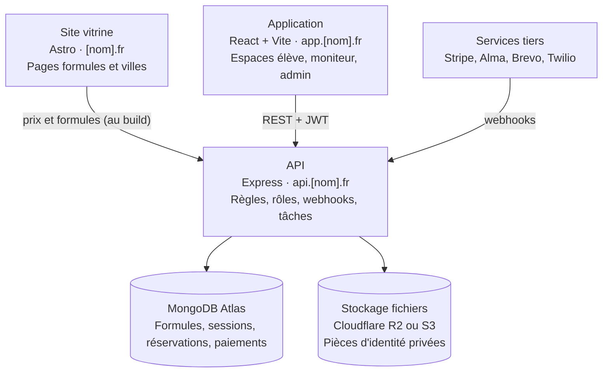
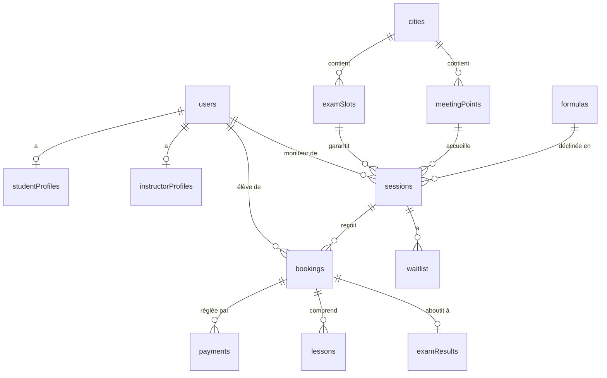
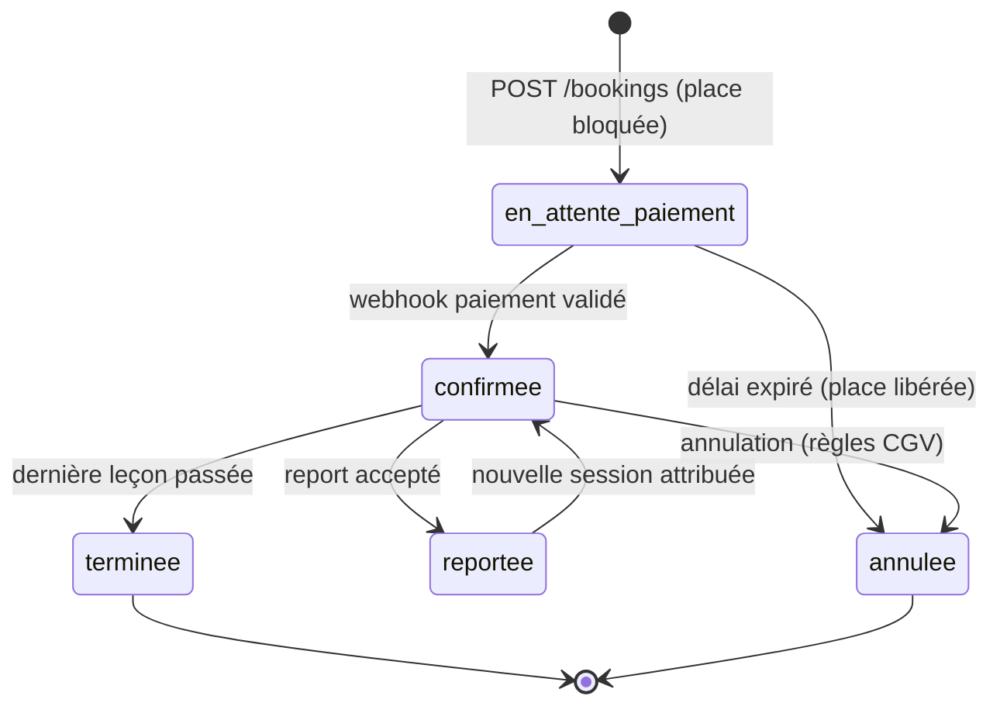

# Cahier des charges — Plateforme d'auto-école en accéléré

Version 1.0 · 5 novembre 2026

## 1. Présentation du projet

Le projet consiste à créer une plateforme d'auto-école spécialisée dans le permis en accéléré : l'élève réserve en ligne un stage intensif dont il connaît les dates, son moniteur et sa date d'examen avant de payer. Le modèle s'inspire de La Navette (lanavette.co), mais la marque, les textes, les visuels et le code sont entièrement originaux.

**Nom provisoire :** `[NOM DE LA MARQUE]` — à définir, avec vérification de la disponibilité du nom de domaine et de la marque.

**Objectifs**

- Permettre à un élève de choisir une formule, une ville, une session et de payer en ligne en moins de 5 minutes.
- Garantir à l'élève, dès l'inscription, ses dates de stage, son moniteur et son créneau d'examen.
- Donner aux moniteurs un planning clair et à l'équipe un back-office pour piloter sessions, places et paiements.
- Attirer les élèves par le référencement naturel (pages formules et pages villes) plutôt que par la seule publicité.

**Hypothèses à confirmer**

- Pays cible : la France est supposée (permis B, CPF, examen national). Un autre pays change le financement, les moyens de paiement et la réglementation de l'examen.
- Le porteur du projet développe seul en V1 ; le périmètre est donc découpé en lots livrables séparément (section 15).
- L'auto-école dispose ou disposera d'un agrément préfectoral et d'un accès aux places d'examen ; la plateforme gère ces places mais ne les obtient pas.

## 2. Référence étudiée et positionnement

On reprend le concept et l'organisation de La Navette, jamais ses contenus. Le tableau résume ce qui a été observé sur leur site le 5 novembre 2026.

| Élément observé | Chez la référence | À reprendre |
| --- | --- | --- |
| Promesse | Permis en 2 semaines, date d'examen garantie sous 3 à 10 jours ouvrés | Oui, avec notre propre formulation |
| Formules | 17 formules : maxi, mini, représentation, passerelle, conduite accompagnée, code, moto | Oui, gamme à définir |
| Prix affichés | Prix total + mensualité « dès X €/mois » sur chaque carte | Oui |
| Réservation | Bouton « Voir les dates » vers l'app élève (formule → sessions) | Oui |
| SEO | Une page par formule et par ville, FAQ riche | Oui |
| Confiance | Avis clients, nombre d'élèves formés, comparatif avec les auto-écoles classiques | Oui, avec nos vrais chiffres uniquement |
| Architecture | Vitrine WordPress + app Rails pour élèves, moniteurs et back-office | Même découpage, autre stack (section 14) |

**Règles d'originalité (obligatoires)**

- Aucun texte, slogan, image, logo, vidéo ou charte graphique copié de la référence.
- Aucun chiffre repris (nombre d'élèves, note, taux de réussite) : on n'affiche que nos propres données vérifiables.
- Identité visuelle propre : nom, logo, couleurs, typographies et univers (la référence utilise un thème spatial, à éviter).
- Le scraper de veille tarifaire sert uniquement à l'analyse concurrentielle interne.

## 3. Périmètre et architecture

La plateforme se compose de trois briques séparées : un site vitrine pour attirer, une application pour réserver et gérer, et une API unique qui porte toutes les règles métier.

La vitrine lit les formules et les prix dans l'API au moment de sa génération ; l'application appelle l'API pour tout le reste ; les prestataires de paiement confirment les réservations par webhook. Seule l'API accède à la base et aux fichiers.

**Dans le périmètre V1 :** permis B manuel et automatique (maxi, mini, représentation, passerelle, conduite accompagnée), code en ligne via un partenaire, une à trois villes de lancement.

**Hors périmètre V1 :** permis moto, application mobile native, CRM, multi-agences avec gestion de stock de véhicules.

## 4. Utilisateurs, rôles et permissions

Quatre profils utilisent la plateforme ; chaque compte porte un seul rôle, vérifié par l'API sur chaque route.

| Rôle | Qui | Accès | Ne peut pas |
| --- | --- | --- | --- |
| Visiteur | Prospect non connecté | Site vitrine, catalogue des formules, dates disponibles, création de compte | Réserver sans compte |
| Élève | Client inscrit | Son profil, ses documents, ses réservations, paiements, planning de conduite, date d'examen | Voir les autres élèves |
| Moniteur | Enseignant salarié ou indépendant | Son planning, ses élèves du moment, points de RDV, saisie de la progression et des heures | Modifier prix, sessions ou paiements |
| Admin | Équipe interne | Tout : formules, sessions, moniteurs, élèves, places d'examen, paiements, remboursements, contenus | — |

Un rôle « Conseiller » (accès en lecture aux élèves et aux réservations, sans accès aux paiements) peut être ajouté en V2 si une équipe commerciale est recrutée.

## 5. Site vitrine

Le site vitrine est statique et pensé pour Google : chaque formule et chaque ville a sa propre page, et tous les boutons de réservation mènent à l'application élève.

| Page | URL | Contenu principal |
| --- | --- | --- |
| Accueil | `/` | Promesse, sélecteur de formules (onglets Voiture manuelle / automatique / conduite accompagnée / code), chiffres clés, avis, méthode, carte des villes, FAQ |
| Toutes les formules | `/permis-accelere/` | Cartes de toutes les formules avec prix et mensualité |
| Page formule | `/permis-accelere/<formule>/` | Déroulé jour par jour, heures, délai d'examen, prix, prérequis, FAQ dédiée, bouton « Voir les dates » |
| Permis automatique / manuel | `/permis-automatique/`, `/permis-manuel/` | Comparatif, formules concernées |
| Permis moto (V2) | `/permis-moto/…` | Même modèle que la voiture |
| Page ville | `/permis-accelere-<ville>/` | Points de RDV de la ville, centres d'examen, formules disponibles, prochaines sessions |
| Nos agences | `/auto-ecole/` | Carte interactive des agences et points de RDV, filtre boîte manuelle / auto |
| Financement | `/financement/…` | CPF, paiement en plusieurs fois, virement, simulateur de mensualités |
| Méthode | `/methode/` | Notre pédagogie, moniteur unique, déroulé type |
| Blog | `/blog/` | Articles conseils pour le SEO |
| FAQ | `/faq/` | Questions fréquentes, balisage FAQ pour Google |
| Recrutement moniteurs | `/devenir-moniteur/` | Formulaire de candidature |
| Légal | `/cgv/`, `/mentions-legales/`, `/confidentialite/` | Documents obligatoires |

**Composants réutilisables :** carte de formule (titre, boîte, badge, prix, mensualité, 4 à 6 points clés, bouton), bloc avis, bloc FAQ, carte des villes, bandeau d'appel à l'action, en-tête avec boutons « Connexion » et « Je m'inscris ».

**Source des données :** les prix et formules affichés sont lus depuis l'API au moment du build (ou via revalidation), pour qu'un changement de prix dans le back-office se répercute sans retoucher le site.

## 6. Application élève

L'élève doit pouvoir passer de « je choisis une formule » à « j'ai payé et je connais mes dates » sans appeler l'auto-école.

**Parcours de réservation**

1. Choix de la formule (depuis la vitrine ou `/formules`).
2. Choix de la ville, puis du point de RDV et de la boîte (manuelle / automatique).
3. Affichage des sessions disponibles : dates de début et de fin, moniteur (prénom + photo), date d'examen prévue, places restantes.
4. Création de compte ou connexion (email + mot de passe, lien magique en option).
5. Saisie des informations : identité, date de naissance, téléphone, adresse, numéro NEPH si déjà obtenu, code obtenu ou non.
6. Choix du mode de paiement : comptant, en plusieurs fois, CPF, virement.
7. Paiement, puis confirmation à l'écran, par email et par SMS.

**Espace élève après réservation**

- Tableau de bord : prochaine leçon, compte à rebours jusqu'à l'examen, moniteur et son téléphone.
- Planning détaillé du stage (jour, heure, point de RDV avec carte).
- Documents à fournir (pièce d'identité, justificatif de domicile, photo ePhoto, ASSR…) avec téléversement et statut « reçu / validé / refusé ».
- Livret d'apprentissage numérique : progression renseignée par le moniteur, compétences validées.
- Paiements : échéancier, factures téléchargeables en PDF, reste à payer.
- Code en ligne (si la formule l'inclut) : accès à l'outil de code, intégré ou partenaire.
- Demande de report ou d'annulation, soumise aux règles de la section 10.
- Messagerie ou chat avec l'équipe.

**Liste d'attente :** si une session est complète, l'élève peut s'inscrire pour être prévenu en cas de désistement.

## 7. Espace moniteur

L'espace moniteur doit être utilisable sur téléphone, en voiture, entre deux leçons : peu d'écrans, gros boutons, chargement rapide.

- **Planning** : vue jour et semaine des leçons, avec élève, heure, point de RDV (lien vers la navigation GPS) et véhicule.
- **Fiche élève** : coordonnées, formule, heures effectuées / prévues, date d'examen, remarques des leçons précédentes.
- **Saisie après chaque leçon** : heures réellement effectuées, compétences travaillées (grille du livret d'apprentissage), commentaire, absence ou retard de l'élève.
- **Avis de fin de stage** : prêt / pas prêt pour l'examen, qui déclenche une alerte à l'admin en cas de « pas prêt ».
- **Disponibilités** : le moniteur déclare ses périodes disponibles et ses congés ; l'admin construit les sessions à partir de ces disponibilités.
- **Récapitulatif mensuel** : heures enseignées, pour la paie ou la facturation des indépendants (export PDF).

Le moniteur ne voit que ses propres élèves et sessions, et n'a accès à aucune donnée de paiement.

## 8. Back-office administrateur

Le back-office est le poste de pilotage : tout ce que l'élève voit (prix, dates, places) se règle ici.

| Module | Fonctions |
| --- | --- |
| Tableau de bord | Réservations du jour et de la semaine, chiffre d'affaires encaissé, taux de remplissage des sessions, examens à venir, documents en attente |
| Formules | Créer, modifier, archiver une formule : nom, catégorie, boîte, heures, durée, prix, mensualité affichée, points clés, ordre d'affichage, badge |
| Villes et points de RDV | Villes, adresses des points de RDV avec coordonnées GPS, centres d'examen rattachés |
| Sessions | Créer une session : formule, point de RDV, moniteur, dates des leçons, nombre de places, créneau d'examen associé ; dupliquer une session ; voir la liste d'attente |
| Places d'examen | Saisie des créneaux d'examen obtenus (date, centre, nombre de places), affectation aux sessions ; une session ne peut pas être publiée sans créneau d'examen |
| Élèves | Recherche, fiche complète, validation des documents, historique, notes internes, transfert vers une autre session |
| Moniteurs | Comptes, disponibilités, véhicules, heures réalisées, évaluations des élèves |
| Paiements | Liste des paiements et échéances, relances, remboursements, export comptable CSV |
| Résultats d'examen | Saisie admis / ajourné, statistiques de réussite par formule, ville et moniteur |
| Contenus | Codes promo, bannières, FAQ (si la vitrine les lit depuis l'API) |
| Journal | Historique des actions sensibles : qui a modifié un prix, remboursé, supprimé |

## 9. Modèle de données

Le cœur du modèle est la chaîne formule → session → réservation : une formule est un produit avec un prix, une session est une occurrence datée de cette formule avec un moniteur et des places, une réservation lie un élève à une session.

| Collection | Champs principaux | Liens |
| --- | --- | --- |
| `users` | email, motDePasseHash, role (eleve, moniteur, admin), prenom, nom, telephone, dateNaissance, adresse, actif, createdAt | — |
| `studentProfiles` | neph, codeObtenu, boitePreferee, documents[] (type, url, statut), notes internes | userId |
| `instructorProfiles` | photo, villes, boites, vehicule, disponibilites[] (debut, fin), statut (salarie, independant) | userId |
| `formulas` | slug, nom, categorie (voiture, conduite_accompagnee, code, moto, passerelle, poids_lourd), boite, heuresConduite, dureeJours, prix (centimes), mensualiteAffichee, pointsCles[], badge, actif, ordre | — |
| `cities` | nom, slug, actif | — |
| `meetingPoints` | nom, adresse, location (GeoJSON), boites | cityId |
| `examSlots` | date, centreExamen, placesTotal, placesAffectees | cityId |
| `sessions` | dates[] (jour, heureDebut, heureFin), placesTotal, placesRestantes, statut (brouillon, publiee, complete, terminee, annulee) | formulaId, meetingPointId, instructorId, examSlotId |
| `bookings` | statut (en_attente_paiement, confirmee, reportee, annulee, terminee), montantTotal, modePaiement, source (site, cpf, agence), expireAt | studentId, sessionId |
| `payments` | montant, statut, prestataire, referencePrestataire, echeance, payeLe | bookingId |
| `lessons` | date, heures, competences[], commentaire, presence | bookingId, instructorId |
| `examResults` | date, resultat (admis, ajourne, absent) | bookingId, examSlotId |
| `waitlist` | createdAt, notifie | studentId, sessionId |
| `auditLogs` | action, avant, apres, date | userId |

**Règles de modélisation :** montants stockés en centimes (entiers) ; dates en UTC ; `placesRestantes` décrémenté de façon atomique (`findOneAndUpdate` avec condition `placesRestantes > 0`) pour éviter la survente ; index sur `sessions.formulaId + statut + dates.jour` et index géospatial sur `meetingPoints.location`.

## 10. API et règles métier

Une seule API REST Express sert la vitrine, l'app et un futur client mobile ; toutes les routes sont préfixées `/api/v1`.

| Groupe | Routes principales | Rôle requis |
| --- | --- | --- |
| Auth | `POST /auth/register`, `/auth/login`, `/auth/refresh`, `/auth/logout`, `/auth/forgot-password` | Public |
| Catalogue | `GET /formulas`, `/formulas/:slug`, `/cities`, `/cities/:slug/meeting-points` | Public |
| Sessions | `GET /sessions?formula=&city=&boite=` (sessions publiées avec places) | Public |
| Réservations | `POST /bookings`, `GET /me/bookings`, `POST /bookings/:id/reschedule`, `/cancel` | Élève |
| Paiements | `POST /bookings/:id/checkout`, `POST /webhooks/payments` | Élève / prestataire |
| Documents | `POST /me/documents`, `GET /me/documents` | Élève |
| Moniteur | `GET /instructor/lessons`, `PATCH /lessons/:id`, `PUT /instructor/availability` | Moniteur |
| Admin | CRUD sur `formulas`, `sessions`, `exam-slots`, `users`, `payments`, `exam-results`, exports | Admin |
| Liste d'attente | `POST /sessions/:id/waitlist` | Élève |

**Cycle de vie d'une réservation**

**Règles métier**

1. **Pas de survente** : une place est bloquée à la création de la réservation (statut `en_attente_paiement`) pendant une durée limitée (15 min proposées, à valider), puis libérée automatiquement si le paiement n'aboutit pas.
2. **Examen garanti** : une session ne peut être publiée que si elle est rattachée à un créneau d'examen ayant assez de places libres ; le nombre de places de la session ne dépasse jamais celui des places d'examen affectées.
3. **Confirmation par webhook** : une réservation ne passe à `confirmee` qu'après réception du webhook de paiement validé, jamais sur simple retour du navigateur.
4. **Report et annulation** : délais et frais à définir dans les CGV (exemple à valider : report gratuit jusqu'à 7 jours avant le début, remboursement partiel ensuite) ; l'API applique la règle, l'admin peut forcer une exception, tracée dans `auditLogs`.
5. **Liste d'attente** : à chaque place libérée, les inscrits sont prévenus par ordre d'inscription.
6. **Fin de session** : passage automatique à `terminee` après la dernière leçon ; rappel d'examen envoyé à l'élève.

**Sécurité de l'API :** JWT d'accès court + refresh token en cookie `httpOnly`, middleware de rôle sur chaque route, validation des entrées (Zod), limitation de débit sur l'auth et les paiements, signature vérifiée sur les webhooks.

## 11. Paiements et financement

Le paiement en plusieurs fois et le CPF sont des arguments de vente majeurs : chaque carte de formule affiche un prix total et une mensualité « dès X €/mois ».

| Mode | Solution proposée | Remarques |
| --- | --- | --- |
| Carte bancaire comptant | Stripe Checkout | Visa, Mastercard, Apple Pay, Google Pay ; webhook `checkout.session.completed` |
| Virement SEPA | Stripe (prélèvement ou virement) | Confirmation différée de plusieurs jours : place bloquée plus longtemps |
| 3 à 4 fois | Alma, Klarna ou Stripe | Le prestataire porte le risque ; l'auto-école est payée en une fois |
| 10 à 24 fois | Organisme de crédit partenaire (type Younited ou Alma) | Contrat de crédit à la consommation, obligations d'information légales |
| CPF | Mon Compte Formation (EDOF) | Nécessite la certification Qualiopi ; la référence indique un plafond de 900 € et, depuis février 2026, un cofinancement employeur d'au moins 100 € pour les salariés — à vérifier auprès de la Caisse des Dépôts |
| Paiement en agence | Saisie manuelle par l'admin | Marquage « payé hors ligne » avec justificatif |

**Exigences**

- Aucune donnée de carte ne transite par nos serveurs (paiement hébergé par le prestataire).
- Facture PDF générée automatiquement à chaque paiement, numérotation continue.
- Remboursements déclenchés depuis le back-office, synchronisés avec le prestataire.
- Codes promo (montant ou pourcentage, date de fin, nombre d'utilisations).

## 12. Exigences non fonctionnelles

La vitrine doit être rapide et bien référencée ; l'app doit être sûre et conforme au RGPD, car elle stocke des pièces d'identité.

**SEO**

- Pages vitrine générées en HTML statique, une URL propre par formule et par ville.
- Balises title et meta description uniques, Open Graph, sitemap.xml, robots.txt, URL canoniques.
- Données structurées : `DrivingSchool` / `LocalBusiness`, `Product` + `Offer` pour les formules, `FAQPage`.
- Contenu unique par page ville (points de RDV, centres d'examen locaux), pas de pages dupliquées.

**Performance**

- Objectif Core Web Vitals au vert sur mobile (LCP < 2,5 s, CLS < 0,1).
- Images en WebP/AVIF, chargement différé, polices auto-hébergées.
- Scripts marketing chargés après consentement et après le contenu.

**Sécurité**

- HTTPS partout, en-têtes de sécurité (CSP, HSTS), mots de passe hachés (bcrypt ou argon2).
- Documents d'identité stockés dans un espace privé, accessibles par URL signée à durée limitée.
- Sauvegardes quotidiennes de la base, restauration testée.
- reCAPTCHA ou équivalent sur inscription et formulaires de contact.

**RGPD et légal**

- Bandeau de consentement cookies (type Axeptio ou Tarteaucitron).
- Politique de confidentialité, droit d'accès et de suppression depuis l'espace élève.
- Durées de conservation définies pour les documents (à fixer avec un conseil juridique).
- CGV couvrant report, annulation, rétractation de 14 jours pour la vente en ligne.

**Accessibilité :** niveau RGAA / WCAG AA visé sur la vitrine et le parcours de réservation.

## 13. Outils tiers et notifications

La V1 se limite aux outils indispensables ; les outils marketing avancés (CRM, enregistrement de sessions) arrivent quand le trafic les justifie.

| Besoin | V1 | Plus tard |
| --- | --- | --- |
| Mesure d'audience | Google Analytics 4 via Google Tag Manager | Segment pour router les événements |
| Publicité | Balises de conversion Google Ads et Meta / TikTok | Suivi des appels téléphoniques |
| Avis clients | Collecte automatique après l'examen (Trustpilot ou Google Avis) | Widget d'avis sur la vitrine |
| Relation client | Formulaire + email | CRM (HubSpot), chat (Intercom ou Crisp) |
| Comportement | — | Hotjar ou Microsoft Clarity |
| Cartes | Mapbox ou Google Maps (points de RDV) | — |
| Vidéo | Hébergement Bunny Stream ou YouTube non répertorié | — |
| Emails transactionnels | Brevo, Resend ou Postmark | — |
| SMS | Brevo ou Twilio | — |

**Notifications automatiques**

| Événement | Destinataire | Canal |
| --- | --- | --- |
| Réservation confirmée | Élève | Email + SMS |
| Document refusé | Élève | Email |
| Veille de la première leçon | Élève, moniteur | SMS |
| Échéance de paiement à venir ou échouée | Élève | Email |
| Nouvel élève dans sa session | Moniteur | Email |
| Place libérée | Inscrits en liste d'attente | Email + SMS |
| Veille de l'examen | Élève | SMS |
| Résultat saisi | Élève | Email (+ demande d'avis si admis) |

## 14. Stack technique et hébergement

La stack reprend des technologies maîtrisées (React, Node.js, MongoDB) pour livrer vite, et ajoute un générateur de site statique pour le SEO de la vitrine.

| Couche | Technologie | Hébergement |
| --- | --- | --- |
| Site vitrine | Astro (ou Next.js en génération statique), Tailwind CSS | Vercel ou Cloudflare Pages |
| Application (élève, moniteur, admin) | React + Vite + TypeScript, React Router, TanStack Query, Tailwind CSS | Vercel |
| API | Node.js + Express + TypeScript, Mongoose, Zod | VPS (Docker + Nginx + PM2) ou Render / Railway — un serveur permanent est préférable aux fonctions serverless pour les webhooks et tâches planifiées |
| Tâches planifiées | node-cron ou BullMQ + Redis (libération des places, rappels, relances) | Même serveur que l'API |
| Base de données | MongoDB Atlas (cluster en région UE) | Atlas |
| Fichiers privés | Cloudflare R2 ou Amazon S3, URL signées | R2 / S3 |
| DNS, CDN, protection | Cloudflare | Cloudflare |
| Code source | Git, monorepo (`apps/vitrine`, `apps/app`, `apps/api`, `packages/shared`) | GitHub |
| CI/CD | GitHub Actions : lint, tests, déploiement | GitHub |

**Domaines**

- `[nom].fr` : site vitrine
- `app.[nom].fr` : application élève, moniteur et admin (espaces séparés par rôle)
- `api.[nom].fr` : API

**Environnements :** développement local, préproduction (`staging`, données de test, paiements en mode test), production. Aucune donnée réelle d'élève en préproduction.

## 15. Planning et lots de livraison

Le projet est découpé en six lots livrés l'un après l'autre ; chaque lot est utilisable seul et le site peut ouvrir dans une ville dès la fin du lot 5. Durées estimées pour un développeur seul, environ 18 semaines au total. Le détail des tâches est dans `docs/ROADMAP.md`.

| Lot | Contenu | Durée estimée | Validation de fin |
| --- | --- | --- | --- |
| 0 · Cadrage et maquettes | Nom et charte, formules et prix, maquettes des écrans clés, prestataires de paiement, CGV | 2 semaines | Marque, formules et prix arrêtés |
| 1 · API et back-office | Modèle de données, auth et rôles, CRUD formules, villes, sessions ; back-office minimal | 4 semaines | — |
| 2 · Réservation et paiement | Parcours élève complet, blocage des places, Stripe et webhooks ; espace élève | 4 semaines | Réservation payée de bout en bout en mode test |
| 3 · Site vitrine | Accueil, formules, villes, FAQ, blog ; données structurées ; prix lus depuis l'API | 3 semaines | — |
| 4 · Moniteurs et alertes | Planning moniteur, saisie des leçons, disponibilités ; emails et SMS, liste d'attente, résultats | 3 semaines | Recette complète en préproduction |
| 5 · Pilote et lancement | Ouverture dans une ville, premiers élèves réels, corrections, suivi des conversions, avis | 2 semaines | Mise en production |

Le lot 3 peut démarrer en parallèle du lot 2 si un intégrateur rejoint le projet.

## 16. Recette, livrables et points à valider

Chaque lot est accepté quand ses scénarios de recette passent en préproduction, avec des paiements en mode test.

**Scénarios de recette clés**

- [ ] Un visiteur réserve une session, paie par carte et reçoit email + SMS de confirmation.
- [ ] Deux élèves tentent de prendre la dernière place en même temps : un seul réussit.
- [ ] Un paiement abandonné libère la place à l'expiration du délai.
- [ ] Une session sans créneau d'examen ne peut pas être publiée.
- [ ] Un moniteur ne voit que ses élèves ; un élève ne voit que ses données.
- [ ] Un changement de prix dans le back-office apparaît sur la vitrine après revalidation.
- [ ] Les pages formules et villes obtiennent un score Lighthouse mobile ≥ 90 en performance et SEO.
- [ ] Un élève demande la suppression de ses données et l'obtient.

**Livrables**

- Code source des trois applications dans le dépôt GitHub, avec README d'installation.
- Documentation de l'API (OpenAPI / Swagger).
- Maquettes des écrans principaux (Figma ou équivalent).
- Guide d'utilisation du back-office pour l'équipe.
- Scripts de sauvegarde et de restauration de la base.

**Points à valider avant de démarrer**

- [ ] Nom de la marque, nom de domaine et dépôt de marque.
- [ ] Pays et villes de lancement.
- [ ] Liste définitive des formules et des prix.
- [ ] Statut juridique, agrément d'auto-école et accès aux places d'examen.
- [ ] Qualiopi (condition du CPF) : oui en V1 ou plus tard.
- [ ] Prestataires de paiement retenus (comptant, plusieurs fois, crédit).
- [ ] Règles de report et d'annulation à inscrire dans les CGV.
- [ ] Charte graphique originale (logo, couleurs, typographies).
